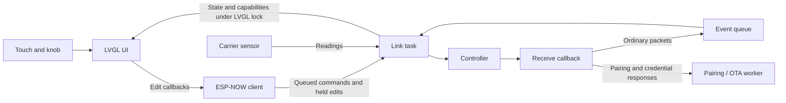

# Architecture

Serin Link is an ESP-IDF application for an ESP32-S3 display dial. It presents
controller state through LVGL and exchanges commands and telemetry over ESP-NOW.
This guide describes the firmware and its native simulator. For build commands,
use [Building and flashing](FLASHING.md); for operation, use the
[user manual](https://serin-labs.com/link/manual.html).

## Source map

| Area | Entry points and responsibility |
| --- | --- |
| Application | [main/dial_main.c](../main/dial_main.c) initializes services and connects UI callbacks to firmware operations. |
| Hardware | [bsp.h](../main/bsp.h) is the board interface; [bsp_viewe.c](../main/bsp_viewe.c) and [bsp_viewe21.c](../main/bsp_viewe21.c) implement display, backlight, and input support. [bsp_touch.c](../main/bsp_touch.c) and [display_runtime.c](../main/display_runtime.c) provide shared touch and display support. |
| UI | [ui.h](../main/ui.h) defines UI state and callbacks. [ui.c](../main/ui.c) manages the home screen, navigation, and interaction; other `main/ui_*.c` files implement screens and drawing helpers. [ui_internal.h](../main/ui_internal.h) contains their shared internal declarations. |
| Radio and protocol | [espnow_client.c](../main/espnow_client.c) manages controller connections, channel selection, commands, pairing, and receive processing. [sl2_proto.h](../main/sl2_proto.h) defines packets; [sl2_ui_map.h](../main/sl2_ui_map.h) and [sl2_info_apply.h](../main/sl2_info_apply.h) translate controller data for the UI. |
| Storage and identity | [prefs.c](../main/prefs.c) stores preferences; [espnow_bond.c](../main/espnow_bond.c) stores controller bonds; [link_crypto.c](../main/link_crypto.c) supplies identity and pairing cryptography. |
| Updates | [link_ota.c](../main/link_ota.c) handles update checks, downloads, and boot validation. [wifi_sta.c](../main/wifi_sta.c) handles temporary station connections. |
| Sensors and diagnostics | [sensor_sht40.c](../main/sensor_sht40.c) samples the optional carrier sensor. [perf_stats.c](../main/perf_stats.c) and [wdt_crumb.c](../main/wdt_crumb.c) provide performance and watchdog diagnostics. |
| Development tools | [sim/](../sim/README.md) builds the real UI with desktop substitutes for hardware services. [test/](../test/run-all.sh) contains host checks; [tools/](../tools/) contains artwork and release tooling. |

## Build and startup

[Kconfig.projbuild](../main/Kconfig.projbuild) selects the board and optional
features. [main/CMakeLists.txt](../main/CMakeLists.txt) selects its BSP and display
dependencies. The board overlays are [sdkconfig.defaults.viewe](../sdkconfig.defaults.viewe)
and [sdkconfig.defaults.viewe21](../sdkconfig.defaults.viewe21).
[project_include.cmake](../main/project_include.cmake) gives each board a distinct
application descriptor name used by OTA image checks. Hardware details belong in
the [hardware guide](HARDWARE.md).

`app_main()` performs the following initialization:

1. Configure power management when enabled, initialize NVS, and record watchdog
   diagnostics.
2. Start the display and performance instrumentation, set the backlight, and
   check the boot-time factory-reset gesture.
3. Under the LVGL port lock, create the UI, register its callbacks, set firmware
   information, and restore the bonded-zone presentation.
4. Start physical input, the optional sensor, the ESP-NOW client, OTA boot
   validation.

`espnow_client_start()` creates the console and pairing worker. With stored
bonds, it initializes the radio and starts `link_task()`. Without bonds, it shows
the pairing prompt; the pairing worker initializes the radio when needed.

## Control and data flow

UI edits call the handlers registered in `app_main()`. Immediate commands enter
the event queue; temperature, band, and fan edits also use pending holds managed
by [edit_hold.h](../main/edit_hold.h). `link_task()` sends pending edits, polls
controllers, searches channels, and processes queued events through
`evt_pump()` and `handle_evt()`. Applied state updates reconcile local edits with
controller replies. Capabilities determine which controls are available.

Pairing runs in `pair_run()`: it exchanges signed identities and ephemeral keys,
derives the peer key, and waits for an authenticated acknowledgement before
persisting the bond.

`link_ota_begin()` submits the update operation to the existing pairing worker.
It requests credentials from the selected controller, pauses ordinary link work,
joins Wi-Fi, and fetches a manifest. After confirmation, the downloader checks
the image's board, version, and hash and completes the ESP-IDF OTA operation.
On a pending-verification boot, a separate `ota_guard_task()` checks rendered UI
and fresh applied controller state before accepting the image or requesting
rollback. Update signing is described in the
[flashing guide](FLASHING.md).

The sensor task samples independently and filters temperature readings. Its read
API applies calibration; the link task forwards eligible readings to controllers.

## Concurrency

- LVGL event and timer callbacks execute in LVGL's context. Calls into UI drawing
  or mutation from other tasks must hold the LVGL port lock. The BSP input
  wrappers in [bsp_common.h](../main/bsp_common.h) acquire it before invoking UI
  callbacks; the link and OTA paths lock around UI updates. `ui_*` functions do
  not generally acquire the lock themselves. `lvgl_port_lock(0)` waits
  indefinitely; calibration uses bounded waits.
- The ESP-NOW receive callback `on_recv()` validates and copies ordinary packets
  into the bounded queue in [espnow_events.h](../main/espnow_events.h), without
  waiting for space. It counts dropped receives when the queue is full and
  discards ordinary packets during pairing and the OTA hold.
- Some receive work happens directly: `PAIR_RESP` fills the pairing response,
  `PAIR_ACK` checks the expected proof under `s_pair_mux`, and `WIFI_RESP` fills
  the pending credential response. The callback also updates peer version,
  signal strength, and receive timestamps. These paths do not pass through
  `handle_evt()` and do not call the UI.
- `link_send_ex()` serializes sends with a mutex and waits on a semaphore signaled
  by `on_send()`. The pairing worker runs pairing or a submitted OTA operation;
  it is distinct from the link task and the OTA boot guard.
- Shared data uses several mechanisms: the bond table has
  its own mutex, sensor bus operations use a bus mutex, and OTA link health uses
  an atomic timestamp. Other status and handoff fields are shared through
  `volatile` flags. Review the readers and writers of any changed field;
  `volatile` alone does not provide mutual exclusion or an atomic multi-field
  snapshot.

## Persistence

Preferences use the NVS namespace `serin`. The `espnow` namespace holds the bond
table and the dial identity. Bonds include the controller address, peer key,
identity, remembered channel, and name. [factory_reset.c](../main/factory_reset.c)
erases both namespaces. The simulator replaces NVS preferences with a local
`.prefs` file through [esp_stubs.c](../sim/stubs/esp_stubs.c).

## Choosing checks

Use the following table to locate checks affected by a change.

| Change | Relevant checks |
| --- | --- |
| Screen layout, navigation, or input behavior | [UI simulator suite](../test/ui_sim/README.md), [child lock](../test/child_lock/), and [reset gesture](../test/reset_gesture/); describe the change for the [user manual](https://serin-labs.com/link/manual.html). |
| Packet format, state mapping, or local edits | [sl2_proto](../test/sl2_proto/), [sl2_ui_map](../test/sl2_ui_map/), [sl2_info_apply](../test/sl2_info_apply/), and [edit_hold](../test/edit_hold/). |
| Radio scheduling, receive handling, or connection health | [espnow_events](../test/espnow_events/), [espnow_background](../test/espnow_background/), [espnow_chscan](../test/espnow_chscan/), and [espnow_liveness](../test/espnow_liveness/). |
| Pairing, bonds, or Wi-Fi setup | [espnow_pair](../test/espnow_pair/), [sl2_pair_auth](../test/sl2_pair_auth/), [espnow_bond](../test/espnow_bond/), and [wifi_setup_session](../test/wifi_setup_session/). |
| OTA selection, download, or boot validation | [ota_ver](../test/ota_ver/), [ota_download](../test/ota_download/), and [ota_guard](../test/ota_guard/). |
| Display, touch, or power behavior | [lvgl_lock](../test/lvgl_lock/), [display_runtime](../test/display_runtime/), [touch_retry](../test/touch_retry/), and [knob_power_save](../test/knob_power_save/); confirm on hardware. |
| Sensor conversion or artwork | [sht40_convert](../test/sht40_convert/) and the [artwork guide](../tools/assets/README.md), respectively. |

[test/run-all.sh](../test/run-all.sh) runs the host suites and reports skips.
Some checks compile extracted functions or inspect source; read the relevant
runner before interpreting its coverage. The simulator entry point is
[sim_main.c](../sim/sim_main.c), built by [sim/Makefile](../sim/Makefile) with the
real UI sources and simulated callbacks. It checks layout and interaction, but
does not establish radio timing, hardware compatibility, or physical performance.
